# CyberDefenders — AfricanFalls Lab

## Overview

[AfricanFalls](https://cyberdefenders.org/blueteam-ctf-challenges/africanfalls/) is a Windows endpoint forensics lab focused on reconstructing a suspect's activity from disk evidence. I examined browser history, FileZilla configuration, Recycle Bin artifacts, Prefetch, PowerShell history, photo metadata, ShellBags, and Windows account data.

The workflow used **FTK Imager 8.3.0.27**, **Autopsy 4.23.1**, **PECmd**, **ShellBags Explorer**, Windows Photos and file properties, and hash lookup results. The following sections document all eleven answers and distinguish direct observations from conclusions that need corroboration.

> **Spoiler warning:** This write-up contains all answers. The accounts, hashes, and activities discussed are part of the CTF scenario.

## Preparing the evidence

I opened `DiskDrigger.ad1` in FTK Imager, reviewed its acquisition log, and exported relevant files for analysis. Exported application data was added to Autopsy as logical files, allowing browser and other user artifacts to be reviewed in its Data Artifacts views.

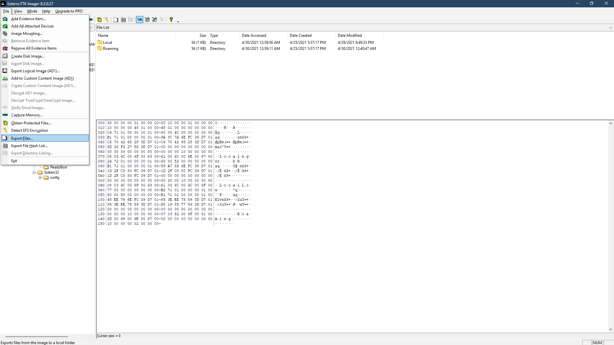

*FTK Imager's Export Files option was used to prepare artifacts for further analysis.*

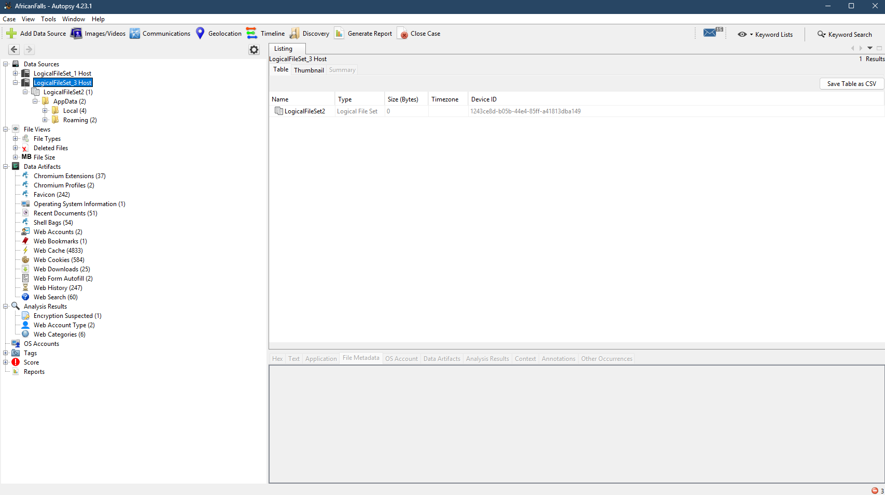

*Autopsy displaying the exported logical file sets. Export-time metadata must not be confused with original activity timestamps.*

## Q1 — What is the MD5 hash value of the suspect disk?

I reviewed **`DiskDrigger.txt`**, the image creation log. Its **Computed Hashes** section records the MD5 checksum, and the **Image Verification Results** section repeats it with a `verified` status:

```text
9471e69c95d8909ae60ddff30d50ffa1
```

This is the image-associated checksum requested by the challenge. The evidence here is the acquisition and verification log, rather than a new hash calculation performed during this walkthrough.

**Answer:** `9471e69c95d8909ae60ddff30d50ffa1`

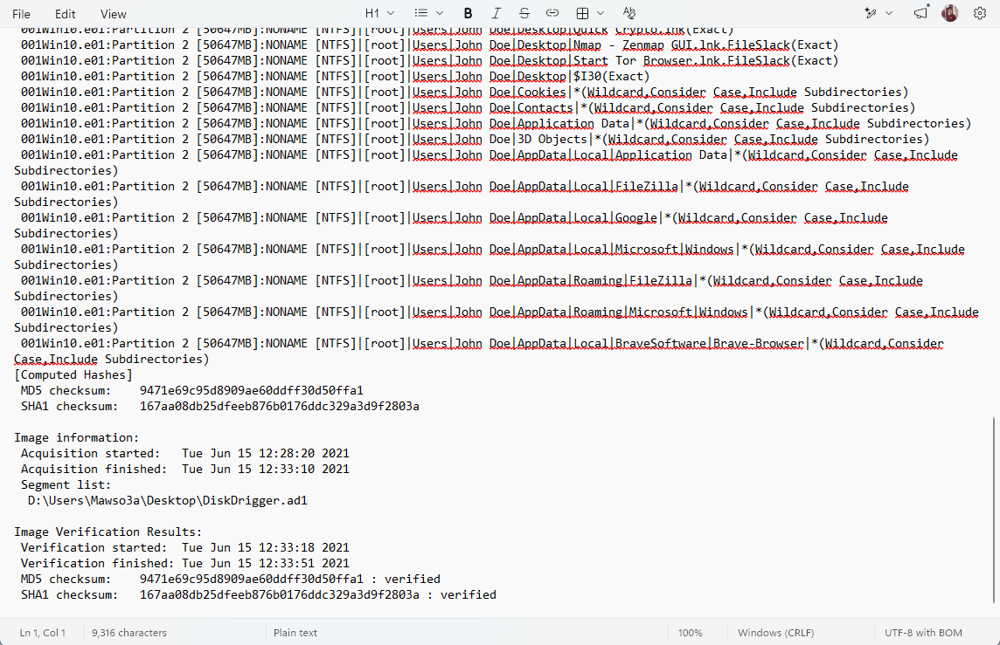

*Both MD5 entries show the same value; the verification section marks it as verified.*

## Q2 — What phrase was searched at 2021-04-29 18:17:38 UTC?

In Autopsy, I opened **Data Artifacts → Web History**, sorted the entries by time, and located the records at **2021-04-29 18:17:38 UTC**. The page title was:

```text
password cracking lists - Google Search
```

The Visit Details pane also displayed the timestamp and a Google search URL containing `q=password+cracking+lists`. Together, the title and query establish the three-word phrase.

The underlying Chrome history database can also be examined at:

```text
C:\Users\John Doe\AppData\Local\Google\Chrome\User Data\Default\History
```

**Answer:** `password cracking lists`

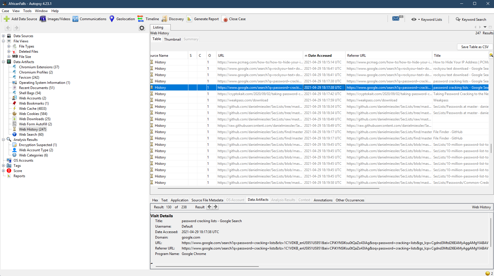

*The selected row and Visit Details pane show the search phrase at the requested time.*

## Q3 — What IPv4 address was used for the FTP server?

FileZilla was the relevant FTP client. Installed-program artifacts can help identify the application, but its user configuration supplied the server address.

I inspected the user's application-data directories and found the useful XML files under **Roaming\FileZilla**. The relevant file was:

```text
C:\Users\John Doe\AppData\Roaming\FileZilla\recentservers.xml
```

FTK Imager's text preview showed:

```xml
<Host>192.168.1.20</Host>
<Port>21</Port>
<User>kali</User>
```

The `Host` value identifies the server in FileZilla's recent-server record. This is configuration/history evidence; it does not by itself establish a successful file transfer.

**Answer:** `192.168.1.20`

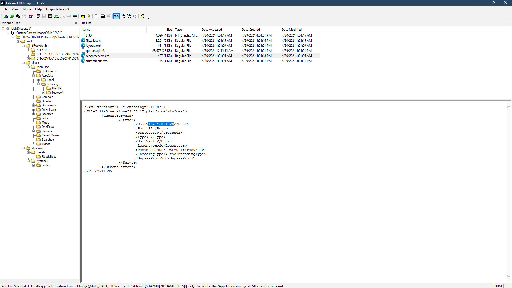

*The highlighted Host element contains the required IPv4 address.*

## Q4 — When was a password list deleted?

I browsed **`C:\$Recycle.Bin`** in FTK Imager and found a matching `$I` and `$R` file pair under a user SID directory. Previewing the `$R` file showed common passwords, identifying it as the password list.

The two files serve different purposes:

| Artifact | Purpose |
|---|---|
| `$R` file | Holds the recycled file's contents |
| `$I` file | Holds metadata, including the original path, size, and deletion time |

The `$R` file's modified timestamp was **2021-04-29 18:19:55**. That describes modification of the content; it is not the deletion time. The screenshot shows the paired `$I` file created and modified at **2021-04-29 18:22:17**, consistent with the minute accepted by the challenge.

My investigation notes record `TimeZoneKeyName` as **UTC** in the SYSTEM hive's active control set:

```text
SYSTEM\<active ControlSet>\Control\TimeZoneInformation\TimeZoneKeyName
```

For an offline SYSTEM hive, the active control set is resolved using `Select\Current`; `CurrentControlSet` is the live-system alias. The timezone observation is documented in the notes rather than a supplied registry screenshot.

**Answer:** `2021-04-29 18:22`

**Timestamp distinction:** The question wording asks for seconds, while the supplied answer field accepts minutes. The screenshot's `$I` filesystem timestamp is `18:22:17`; a precise forensic deletion time should be confirmed by decoding the deletion timestamp stored inside `$I`. The `$R` modified time should not be substituted for it.

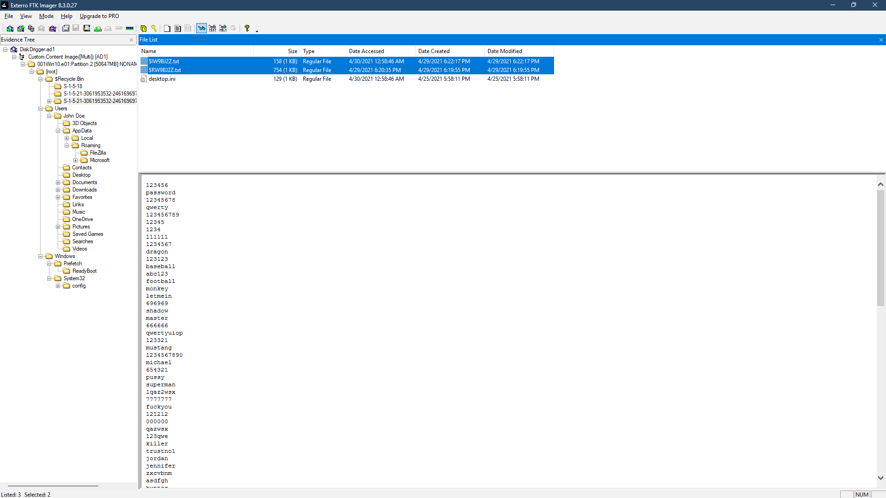

*The preview identifies the password list, while the paired metadata file's timestamps point to the accepted deletion minute.*

## Q5 — How many times was Tor Browser run?

I inspected Prefetch artifacts under:

```text
C:\Windows\Prefetch
```

The Tor-related record was associated with **`TORBROWSER-INSTALL-WIN64-10.0`**, with Prefetch hash **`F3C4DF19`**. The supplied PECmd output shows:

```text
Executable name: TORBROWSER-INSTALL-WIN64-10.0
Hash: F3C4DF19
Run count: 1
Last run: 2021-04-29 18:22:32
```

The important distinction is the executable name: this record belongs to the **installer**. Its run count of one does not count launches of the installed browser.

PECmd can parse an exported Prefetch file and produce CSV output for inspection. The notes also describe no timestamp in `PreviousRun0`. An empty previous-run field is consistent with only one recorded execution of this installer; it does not independently prove that Tor Browser never ran.

**Answer:** `0`

The accepted lab answer is zero browser launches. The displayed evidence directly supports one installer execution; establishing zero browser executions more broadly requires reviewing the available browser execution artifacts, not simply reinterpreting the installer's run count.

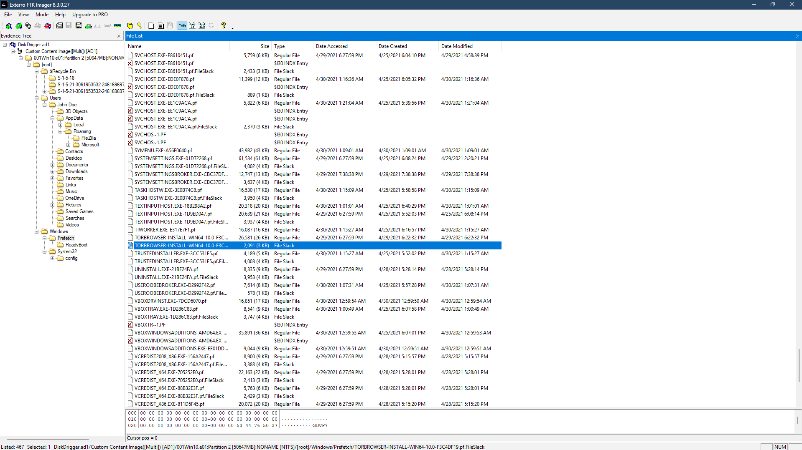

*The listing contains the regular Prefetch file and a FileSlack entry. The regular `.pf` file is the artifact to export for parsing.*

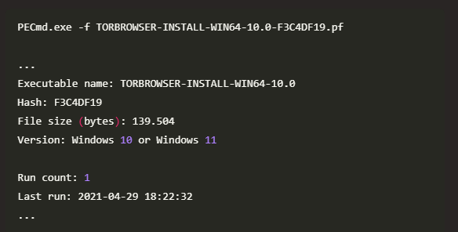

*The executable name identifies the installer, explaining why this count is not a browser launch count.*

## Q6 — What is the suspect's email address?

In Autopsy, I opened **Data Artifacts → Web History** and narrowed the review to ProtonMail-related entries. Selecting the inbox visit revealed the following title in the lower **Visit Details** pane:

```text
Inbox | dreammaker82@protonmail.com | ProtonMail
```

The selected visit is timestamped **2021-04-30 01:05:11 UTC** and uses `https://mail.protonmail.com/inbox`. The address in the page title supplies the answer.

**Answer:** `dreammaker82@protonmail.com`

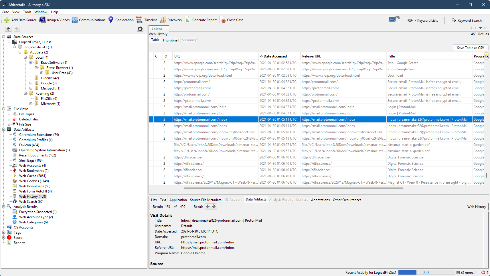

*The Title field in Visit Details contains the full email address.*

## Q7 — Which FQDN did the suspect port scan?

To identify commands entered in PowerShell, I examined its saved console history:

```text
C:\Users\John Doe\AppData\Roaming\Microsoft\Windows\PowerShell\PSReadLine\ConsoleHost_history.txt
```

The file contains:

```powershell
ping dfir.science
nmap dfir.science
```

The `nmap` command identifies **dfir.science** as the intended scan target. This is a record of the command, not scan output, so it does not establish which ports were found open or whether the command succeeded.

**Answer:** `dfir.science`

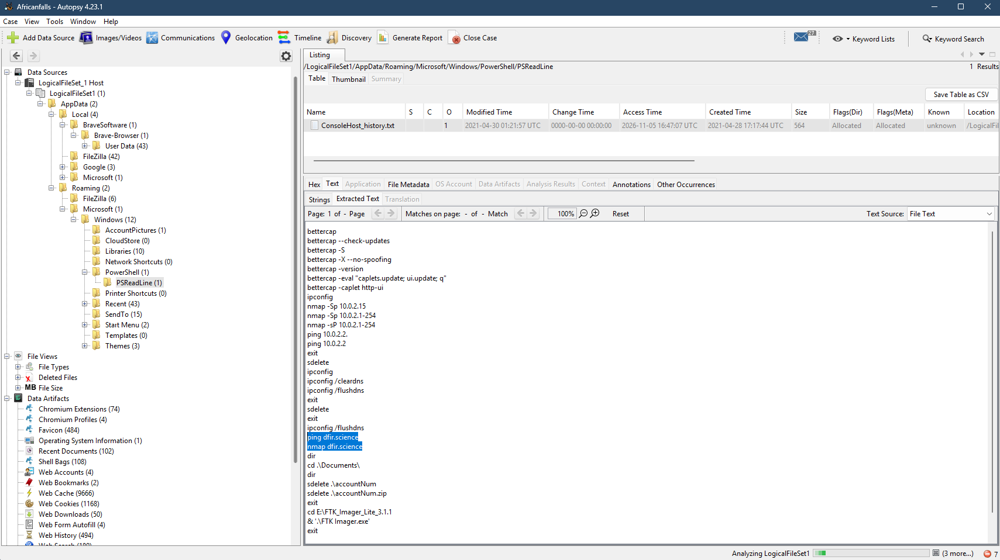

*The highlighted Nmap invocation supplies the target FQDN.*

## Q8 — In which country was 20210429_152043.jpg allegedly taken?

I located the image in the user's **Pictures\Contact** folder, exported it, and examined its metadata in Windows Photos and file properties.

Properties displayed GPS magnitudes of **16 degrees latitude** and **23 degrees longitude**. Photos identified **Nalolo**, and the captured coordinate lookup used **16° S, 23° E**, equivalent to **-16, 23**. Its map result was **Nalolo District, Zambia**.

The hemisphere references matter: unsigned values of 16 and 23 alone do not establish a unique location. In this workflow, the Photos location and the mapped southern-latitude/eastern-longitude result provide the geographic context. A complete EXIF review should preserve the latitude and longitude reference fields as well as their numerical values.

**Answer:** `Zambia`

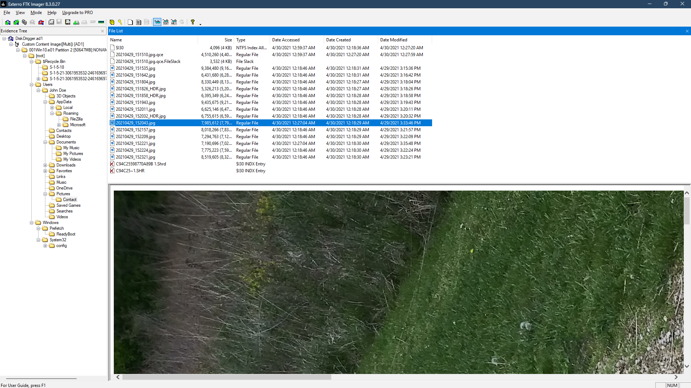

*The selected evidence filename is `20210429_152043.jpg`.*

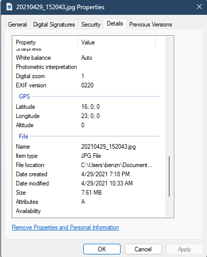

*The GPS section displays 16 degrees latitude and 23 degrees longitude.*

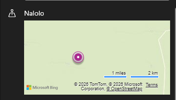

*Photos supplies the place-name clue, Nalolo.*

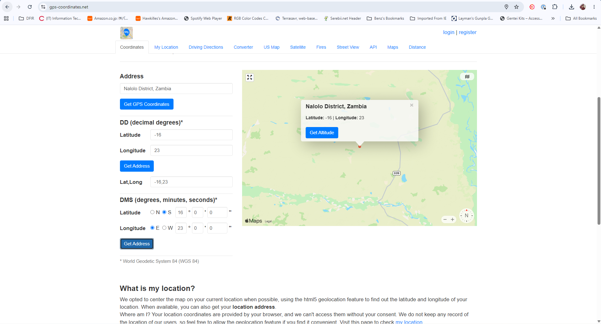

*The supplied map screenshot identifies Nalolo District, Zambia. This describes the metadata's alleged location, not independent proof of where the photograph was taken.*

## Q9 — What was the photo's original parent folder?

For **`20210429_151535.jpg`**, I combined camera metadata with ShellBags evidence. The photo metadata showed an **LG Electronics LM-Q725K** device. The investigation associated it with an **LG Q7**, which also appeared in the folder history.

I exported the user's registry hive from:

```text
C:\Users\John Doe\AppData\Local\Microsoft\Windows\UsrClass.dat
```

Opening it in ShellBags Explorer exposed this hierarchy:

```text
Desktop\This PC\LG Q7\Internal storage\DCIM\Camera
```

The final folder name was **Camera**, providing the challenge answer. ShellBags record folder interaction; correlating the phone folder with the photo's device metadata supports the source-folder inference, but the ShellBag alone is not a file-copy log.

**Answer:** `Camera`

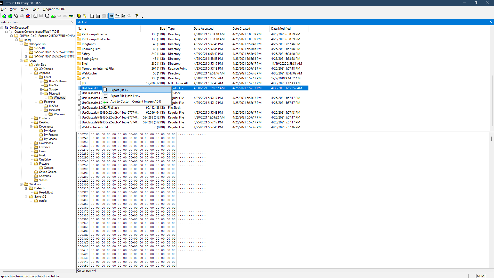

*The selected hive contains the user's ShellBags artifacts.*

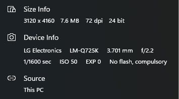

*The camera metadata provides the device clue.*

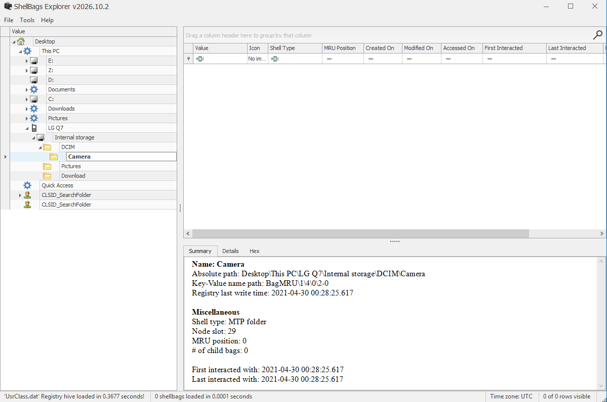

*The folder tree and Absolute path field identify `Camera` as the final component.*

## Q10 — What is the password for the supplied Anon hash?

The question supplies a Windows password-hash record:

```text
Anon:1001:aad3b435b51404eeaad3b435b51404ee:3DE1A36F6DDB8E036DFD75E8E20C4AF4:::
```

The relevant NT hash is the fourth colon-delimited field:

```text
3DE1A36F6DDB8E036DFD75E8E20C4AF4
```

The captured Hashes.com lookup result maps that value to **`AFR1CA!`**. This documents a hash lookup result rather than a locally demonstrated brute-force run.

**Answer:** `AFR1CA!`

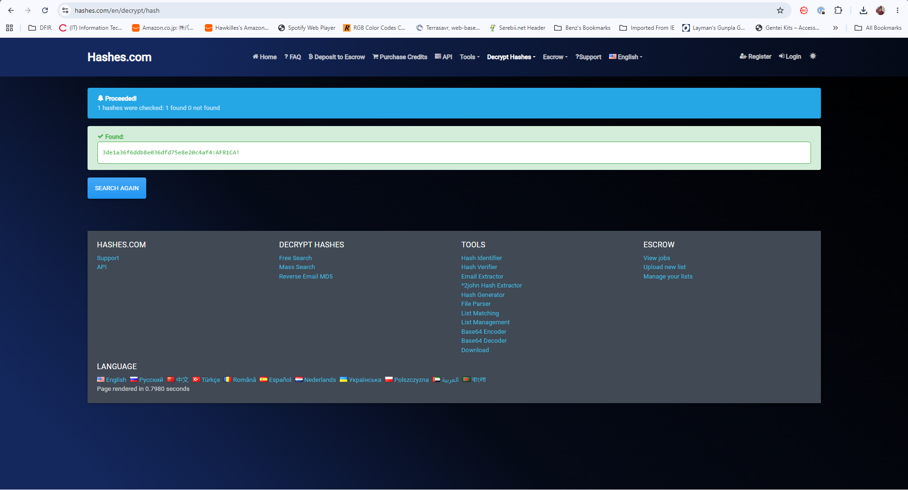

*The recovered value uses the digit `1`, followed by `CA!`.*

## Q11 — What is John Doe's Windows login password?

This question required identifying the local account's hash from the forensic image. The relevant registry hives are:

```text
C:\Windows\System32\config\SAM
C:\Windows\System32\config\SYSTEM
```

The SAM stores protected local-account password hashes; the SYSTEM hive provides information needed to recover them offline. My notes describe exporting these hives with FTK Imager and using Mimikatz's offline SAM functionality:

```text
lsadump::sam /system:<exported-SYSTEM-path> /sam:<exported-SAM-path>
```

The notes identify John Doe's NT hash as:

```text
ecf53750b76cc9a62057ca85ff4c850e
```

The supplied screenshots show the SAM artifact and the subsequent lookup result, rather than the intermediate Mimikatz output. The Hashes.com result maps this hash to **`ctf2021`**.

**Answer:** `ctf2021`

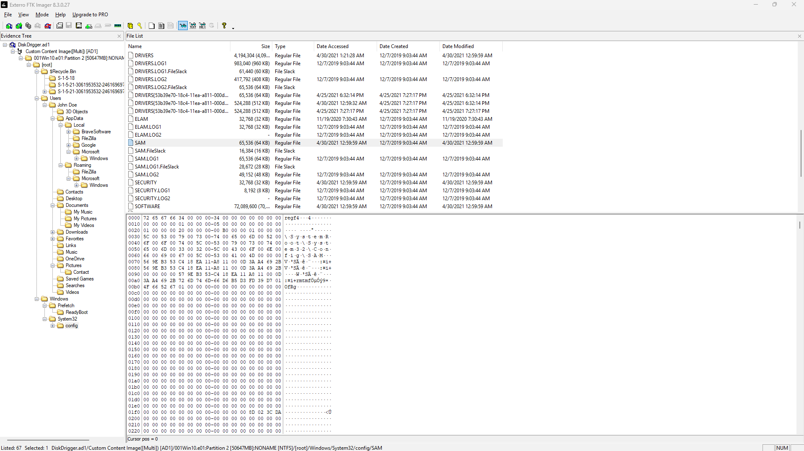

*FTK Imager identifies the SAM hive used in the documented offline extraction workflow.*


*The lookup result supplies the final password. The SAM/SYSTEM procedure belongs to Q11; Q10 already provides its hash in the question.*

## Findings and takeaways

Browser history established the password-list search and an email address. FileZilla's recent-server configuration identified an FTP host, PowerShell history identified an intended scan target, and recycled file contents revealed a password list. Photo metadata and ShellBags supplied complementary clues about location and device folders. The final questions connected lab account hashes to their recovered passwords.

The key lesson was to read each artifact according to what it records: a file modification time is not a deletion time, an installer execution is not a browser launch, and a folder-history record is not a copy transaction. Preserving these distinctions makes the answers easier to explain and the investigation more defensible.

## Reference

- [CyberDefenders — AfricanFalls](https://cyberdefenders.org/blueteam-ctf-challenges/africanfalls/)
