# CyberDefenders — Insider Lab

## Overview

[Insider](https://cyberdefenders.org/blueteam-ctf-challenges/insider/) is a Linux endpoint forensics challenge centered on investigating suspected insider activity. I used **Exterro FTK Imager 8.3.0.27** to examine the supplied evidence and **PowerShell** to calculate a file hash.

The investigation covered operating system identification, downloaded files, Bash history, authentication logs, scripts, and image evidence. This walkthrough follows the eleven challenge questions and documents the artifacts behind each answer.

> **Spoiler warning:** All eleven answers are included. The screenshots and activity discussed belong to the CTF scenario.

## Evidence and approach

I opened `FirstHack.ad1` in FTK Imager and browsed the captured Linux filesystem. The evidence tree exposes directories including `/boot`, `/root`, and `/var`. I inspected files through FTK Imager's preview pane and exported the Apache access log for hashing.

Commands quoted from Bash history and scripts below are evidence being examined, not instructions executed during the analysis. Timestamps are described as displayed; the screenshots do not establish a timezone for the Linux authentication log.

## Q1 — Which Linux distribution was used?

I examined `/boot`, where several kernel-related filenames included the string `kali`:

```text
config-4.13.0-kali1-amd64
initrd.img-4.13.0-kali1-amd64
System.map-4.13.0-kali1-amd64
vmlinuz-4.13.0-kali1-amd64
```

These Kali-specific kernel filenames provide the distribution clue for the challenge.

**Answer:** `kali`

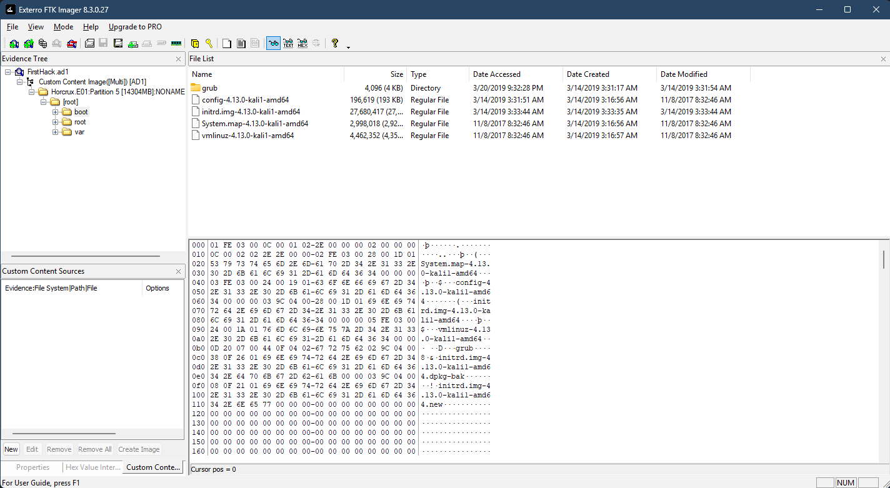

*The `kali1-amd64` portion of the filenames identifies the relevant distribution.*

## Q2 — What is the MD5 hash of Apache's access.log?

I navigated to `/var/log/apache2/access.log`, selected **Export Files**, and calculated the exported file's MD5 hash in PowerShell. Using a generic export location, the command is:

```powershell
Get-FileHash "C:\Evidence\access.log" -Algorithm MD5
```

The output shown in the screenshot was:

```text
D41D8CD98F00B204E9800998ECF8427E
```

This is the MD5 value for an empty file, consistent with FTK Imager displaying a size of zero bytes.

**Answer:** `D41D8CD98F00B204E9800998ECF8427E`

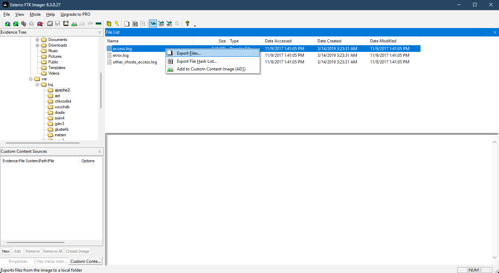

*The selected artifact is `/var/log/apache2/access.log`.*

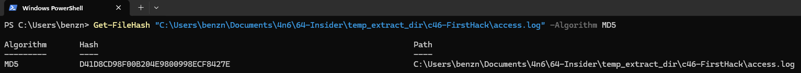

*The Hash column contains the MD5 value submitted for the challenge.*

## Q3 — Which credential-dumping archive was downloaded?

I browsed `/root/Downloads` and found the archive `mimikatz_trunk.zip`. Its filename identifies the downloaded file requested by the challenge. The archive's presence alone does not demonstrate that its contents were executed.

**Answer:** `mimikatz_trunk.zip`

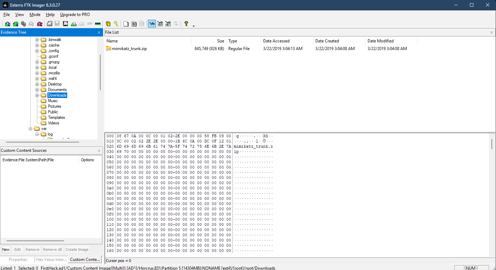

*The archive appears in the file listing for `/root/Downloads`.*

## Q4 — Where was the super-secret file created?

I inspected `/root/.bash_history` and found commands redirecting output to a file on the Desktop:

```bash
touch snky snky > /root/Desktop/SuperSecretFile.txt
cat snky snky > /root/Desktop/SuperSecretFile.txt
```

The absolute destination path is visible in both entries. The `>` operator creates or truncates its destination when the shell can open the file; the history provides the intended path without showing command results.

**Answer:** `/root/Desktop/SuperSecretFile.txt`

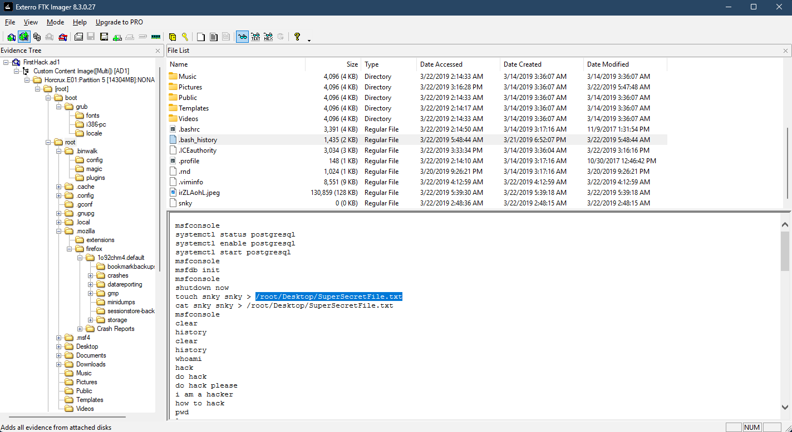

*The highlighted path identifies the file on the Desktop.*

## Q5 — Which program used didyouthinkwedmakeiteasy.jpg?

Further inspection of `/root/.bash_history` revealed:

```bash
binwalk didyouthinkwedmakeiteasy.jpg
```

The command directly associates the image with the program `binwalk`. The history records the invocation, but does not show its output or whether anything was extracted.

**Answer:** `binwalk`

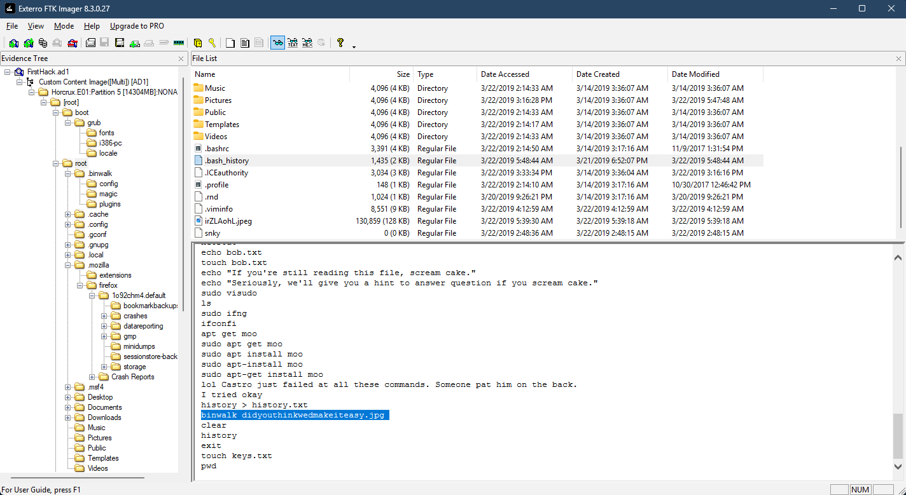

*The highlighted command names the program and its image argument.*

## Q6 — What was Karen's third checklist goal?

I opened `/root/Desktop/Checklist` in FTK Imager. Its contents listed three goals:

```text
Check List:

- Gain Bob's Trust
- Learn how to hack
- Profit
```

The third entry was **Profit**.

**Answer:** `Profit`

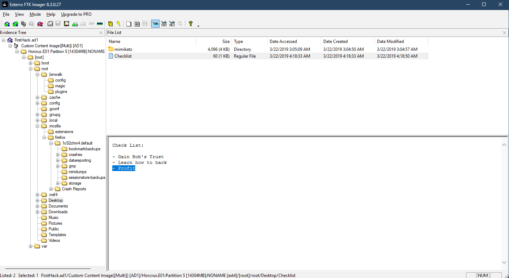

*The highlighted final entry supplies the answer.*

## Q7 — How many times was Apache run?

I reviewed the files under `/var/log/apache2`. The screenshot shows all three listed logs as zero bytes:

| File | Size |
|---|---|
| `access.log` | 0 bytes |
| `error.log` | 0 bytes |
| `other_vhosts_access.log` | 0 bytes |

The accepted challenge answer is **0**, consistent with the absence of entries in these logs.

**Evidence limitation:** Empty logs alone do not prove that Apache never started. Logs can be cleared, disabled, or stored elsewhere, and an access log records requests rather than service start counts. A real investigation would corroborate this conclusion with service or system logs.

**Answer:** `0`

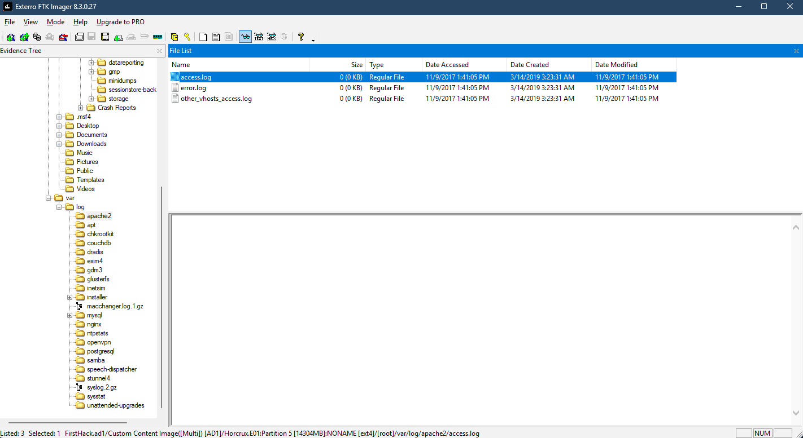

*The Size column shows zero bytes for each listed log.*

## Q8 — Which file contains evidence related to the attack?

In `/root`, I located `irZLAohL.jpeg` and opened its image preview. It contains a screenshot of a Windows desktop with an Administrator command prompt. The prompt shows `aylmao.exe` displaying the **AlphaSOC Network Flight Simulator** help text, followed by a visible `aylmao.exe run` command line.

The screenshot is the evidence file requested by the challenge. It documents the displayed tool and command context, but does not independently establish a successful attack or identify a remote target.

**Answer:** `irZLAohL.jpeg`

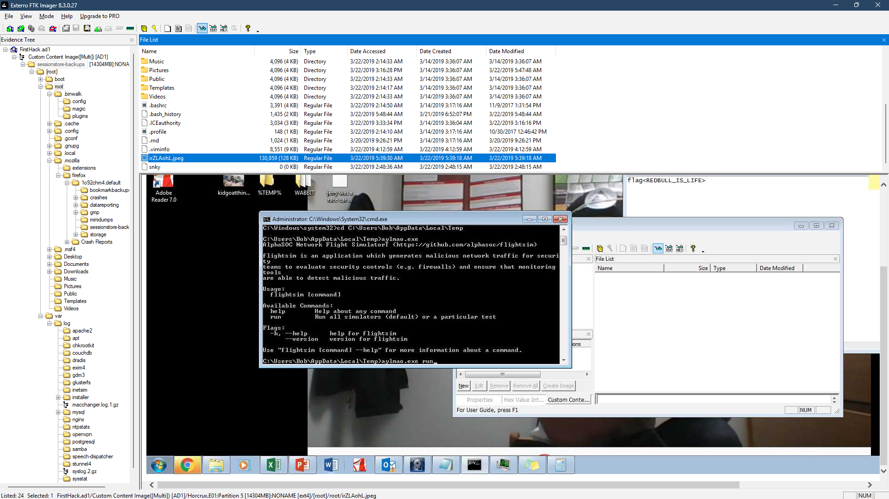

*The selected filename identifies the artifact; the preview contains the relevant command prompt.*

## Q9 — Who was Karen taunting in the script?

I examined `/root/Documents/myfirsthack/firstscript_fixed`. The script contains commands for displaying the working directory, default route, and network connections, followed by:

```bash
echo "Heck yeah! I can write bash too Young"
```

The final line names **Young** as the person being addressed.

**Answer:** `Young`

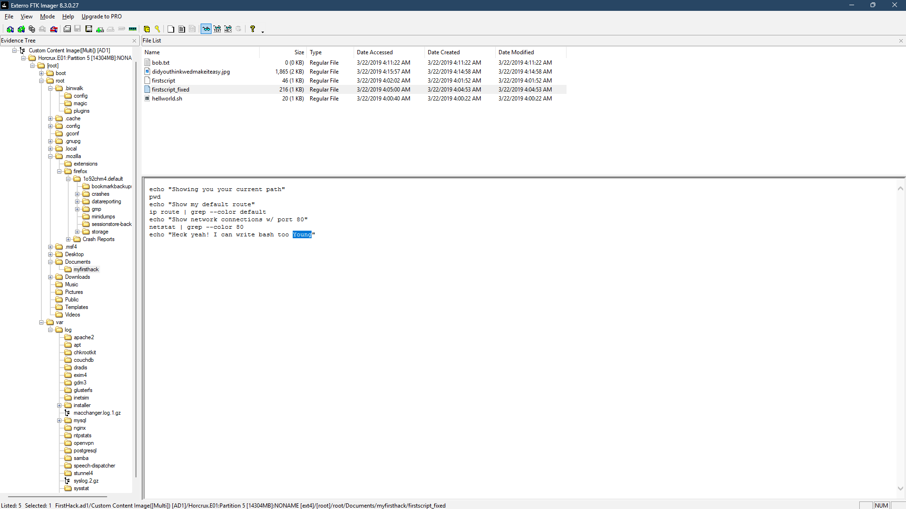

*The highlighted name appears in `firstscript_fixed`.*

## Q10 — Which account appears in the repeated su activity at 11:26?

I reviewed `/var/log/auth.log` around **March 20, 11:26**. Multiple entries at `11:26:22` and `11:26:23` name `postgres`, including:

```text
Successful su for postgres by root
+ ??? root:postgres
pam_unix(su:session): session opened for user postgres by (uid=0)
```

These entries identify **postgres**, the accepted challenge answer.

**Interpretation note:** The question describes a user gaining root access, but the displayed records show the opposite direction: **root switching to postgres**. In particular, “for postgres by root” identifies `postgres` as the target account and `root` as the initiating account. The screenshot does not show `postgres` elevating to root.

**Answer:** `postgres`

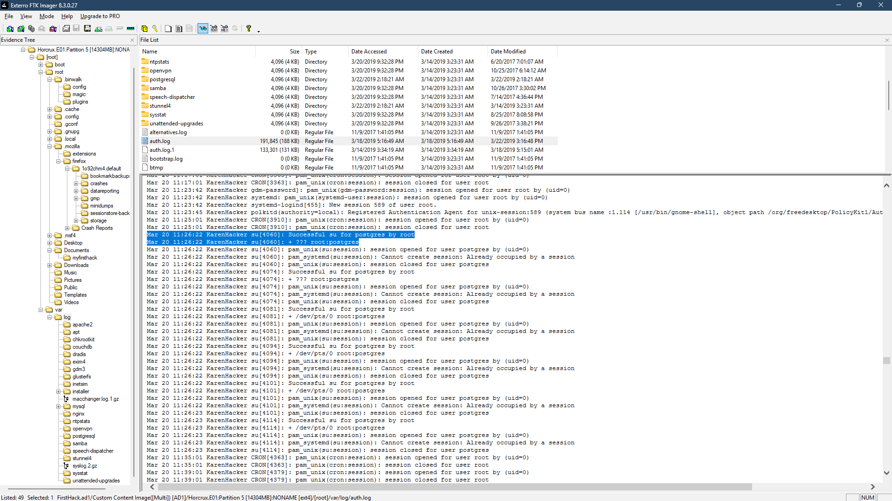

*The repeated `Successful su for postgres by root` entries provide the account name and clarify the direction of the switch.*

## Q11 — What working directory can be reconstructed from Bash history?

I returned to `/root/.bash_history` and traced the directory changes rather than relying on a single highlighted path fragment. The relevant sequence includes:

```bash
cd /root
cd ../root
cd ../root/Documents/myfirsthack/../../Desktop/
cd ../Documents/myfirsthack/
```

Starting from `/root`, `cd ../root` stays in `/root`. The longer relative path then resolves to `/root/Desktop`. From there, the final `cd ../Documents/myfirsthack/` resolves to:

```text
/root/Documents/myfirsthack/
```

No later directory-changing command is visible in the remaining history shown. Assuming these directory changes succeeded, this is the final working directory reconstructed for the challenge. The later `pwd` entries record commands, not their output.

**Answer:** `/root/Documents/myfirsthack/`

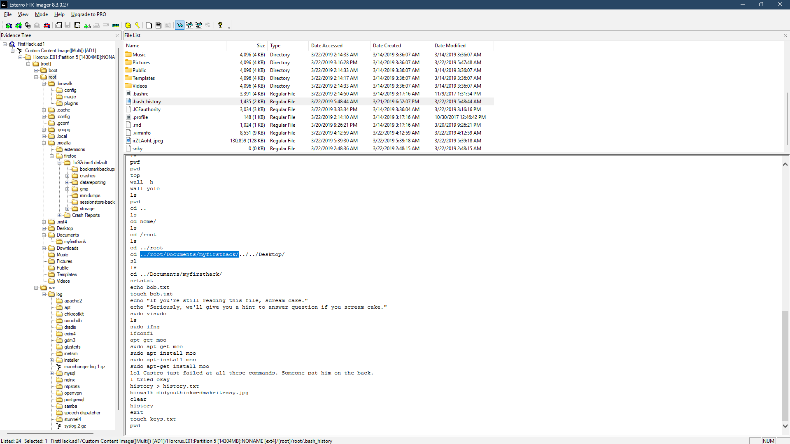

*The final visible `cd ../Documents/myfirsthack/` establishes the answer after resolving the preceding path changes.*

## Findings and takeaways

The captured filesystem contained Kali kernel artifacts, a downloaded Mimikatz archive, a checklist, shell scripts, and Bash history documenting file paths and tool invocations. Authentication logs supplied account-switching evidence, while a JPEG preserved a separate command-prompt view relevant to the challenge.

The most useful lesson was to distinguish an artifact's contents from the conclusion drawn from it. Bash history records commands without their results, empty logs do not establish an exact service execution count, and authentication messages must be read carefully to determine which account initiated a switch. Combining file listings, content previews, hashes, and log entries produced a more defensible account of the activity.

## Reference

- [CyberDefenders — Insider](https://cyberdefenders.org/blueteam-ctf-challenges/insider/)
