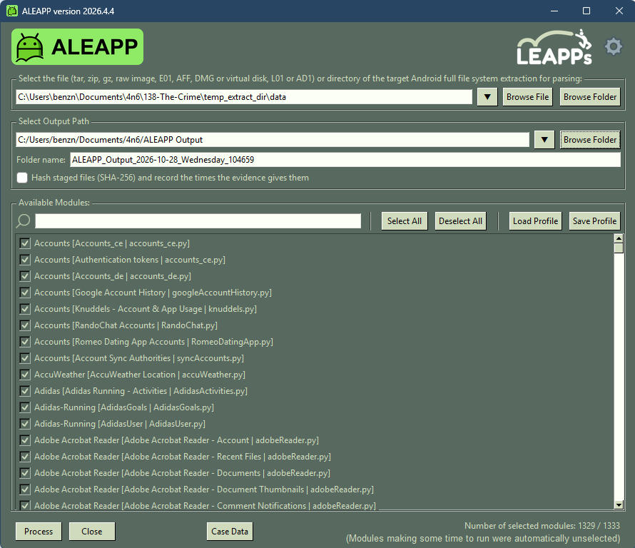
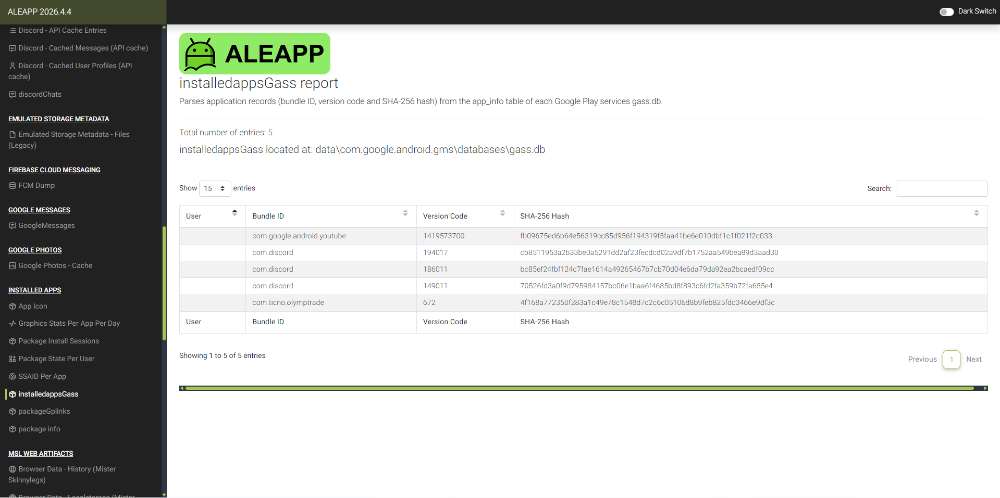
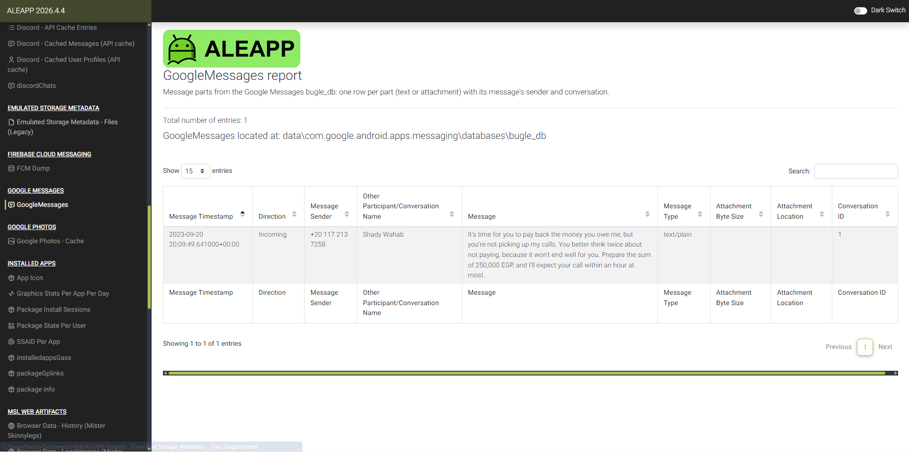
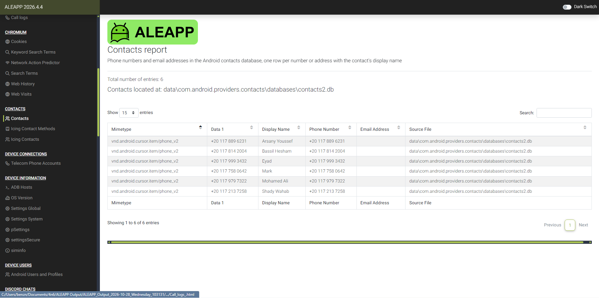
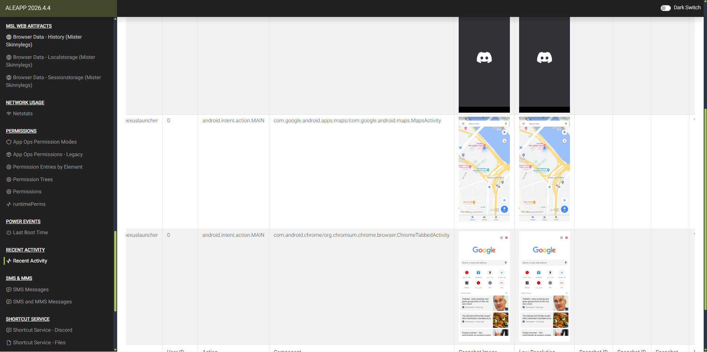
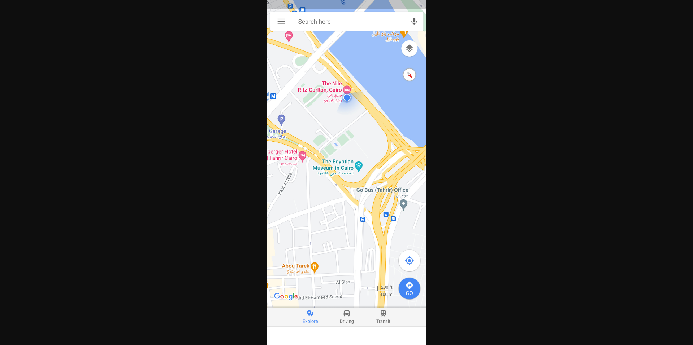
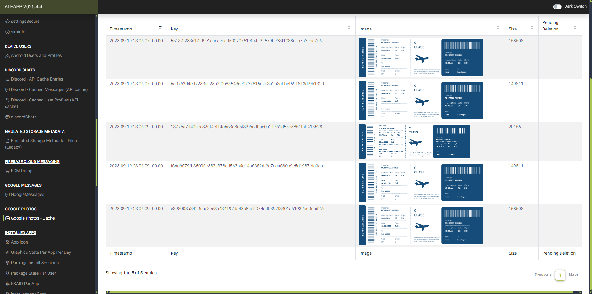
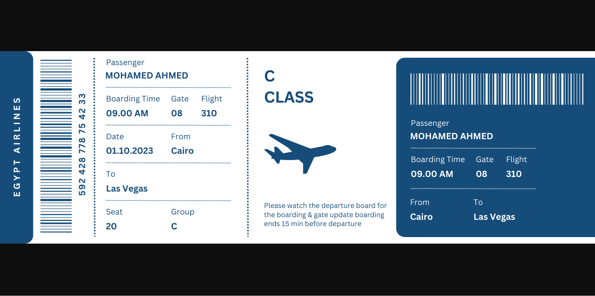
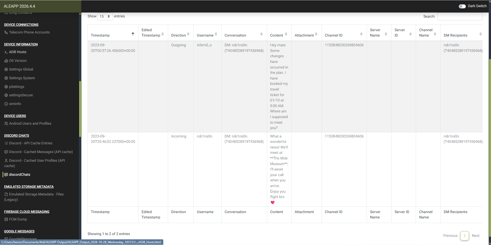

# CyberDefenders — The Crime: Android Forensics with ALEAPP

## Overview

[The Crime](https://cyberdefenders.org/blueteam-ctf-challenges/the-crime/) is an Android forensics challenge focused on reconstructing a victim's financial activity, communications, and travel plans.

I used [ALEAPP — Android Logs Events And Protobuf Parser](https://github.com/abrignoni/ALEAPP) to process the extracted phone data and review the resulting HTML reports. The screenshots show ALEAPP version **2026.4.4**.

> **Spoiler warning:** This write-up includes all six challenge answers. The evidence shown belongs to the CTF scenario.

## Processing the evidence

I loaded the extracted Android `data` directory into ALEAPP, selected an output location, and processed the selected artifact modules. I then reviewed the reports for installed applications, messages, contacts, recent activity, cached photos, and Discord conversations.



*ALEAPP setup used to process the extracted Android data.*

## Q1 — Identifying the trading application

The first question asks for the SHA-256 hash of the trading application associated with the victim's investments.

I opened **Installed Apps → installedappsGass**. This report displays application records parsed from the `app_info` table in:

```text
data\com.google.android.gms\databases\gass.db
```

The report included **`com.ticno.olymptrade`**, identifying the relevant application as Olymp Trade. Its row contained version code `672` and the SHA-256 value required by the challenge.

This hash was recorded in the application metadata displayed by ALEAPP; I did not calculate it from an APK during this walkthrough.

**Answer:**

```text
4f168a772350f283a1c49e78c1548d7c2c6c05106d8b9feb825fdc3466e9df3c
```



*The final row links `com.ticno.olymptrade` to the required SHA-256 value.*

## Q2 — Determining the amount owed

The witness account described repeated calls from someone the victim owed money. I opened **GoogleMessages**, which parsed message content from:

```text
data\com.google.android.apps.messaging\databases\bugle_db
```

An incoming message dated **September 20, 2023, at 20:09:49 UTC** demanded repayment and referred directly to the victim ignoring calls:

> “Prepare the sum of 250,000 EGP, and I'll expect your call within an hour at most.”

The message established the requested repayment amount as **250,000 Egyptian pounds**. The challenge requires the numeric value without punctuation or a currency label.

**Answer:** `250000`



*The Message column contains the amount, “250,000 EGP,” and the reference to unanswered calls.*

## Q3 — Identifying the creditor

The same message record associated the incoming message with **Shady Wahab**, using the phone number `+20 117 213 7258`.

To corroborate the name, I opened **Contacts**. ALEAPP parsed these records from:

```text
data\com.android.providers.contacts\databases\contacts2.db
```

The contact entry for **Shady Wahab** matched the sender's phone number. Correlating the message with the contact record identified the person demanding repayment.

**Answer:** `Shady Wahab`



*The final contact row matches the name and phone number shown in the repayment message.*

## Q4 — Establishing the victim's location

The next question asks where the victim went after leaving home on September 20, 2023.

I reviewed **Recent Activity** and located a Google Maps entry with this application component:

```text
com.google.android.apps.maps/com.google.android.maps.MapsActivity
```

The entry included a saved application snapshot. Opening it revealed a blue location indicator beside **The Nile Ritz-Carlton, Cairo**.

This snapshot provides the location clue used to answer the challenge. The screenshot does not display a timestamp independently linking the snapshot to September 20; the date comes from the question's context.

**Answer:** `The Nile Ritz-Carlton`



*The Google Maps row contains the saved map view.*



*The hotel label and blue location indicator provide the location clue.*

## Q5 — Recovering the intended travel destination

In **Google Photos → Google Photos - Cache**, I found several cached images of a boarding pass. Opening one revealed:

| Field | Value |
|---|---|
| Passenger | Mohamed Ahmed |
| From | Cairo |
| To | Las Vegas |
| Date | 01.10.2023 |
| Boarding time | 09.00 AM |
| Flight | 310 |

The **To** field identified **Las Vegas** as the intended destination. The boarding pass supports the travel plan; it does not establish that the victim actually boarded the flight.

**Answer:** `Las Vegas`



*Cached boarding pass images recovered in the Google Photos report.*



*The “To” field reads “Las Vegas” on both portions of the boarding pass.*

## Q6 — Finding the planned meeting location

I opened **Discord Chats → discordChats** to examine the victim's conversations.

An outgoing message from **`infern0_o`** mentioned a travel ticket booked for **01/10 at 9:00 AM** and asked where to meet. These details were consistent with the recovered boarding pass.

The incoming response from **`rob1ns0n.`**, timestamped **September 20, 2023, at 20:46:02 UTC**, named **The Mob Museum** as the meeting location and asked the victim to call upon arrival.

**Answer:** `The Mob Museum`



*The incoming message in the second row names “The Mob Museum.” The preceding message supplies the travel context.*

## Findings and takeaways

The reports identified the victim's trading application and a repayment demand for **250,000 EGP** from **Shady Wahab**. A Google Maps snapshot pointed to **The Nile Ritz-Carlton**, while a cached boarding pass documented planned travel to **Las Vegas**. Discord supplied the final detail: an intended meeting at **The Mob Museum**.

This challenge demonstrated the value of correlating Android artifacts. Messages established the debt, contacts corroborated the sender's identity, and cached images and conversations revealed the victim's plans. Keeping the source artifact and its limitations in view helped distinguish recorded plans from confirmed actions.

## References

- [CyberDefenders — The Crime](https://cyberdefenders.org/blueteam-ctf-challenges/the-crime/)
- [ALEAPP repository](https://github.com/abrignoni/ALEAPP)
